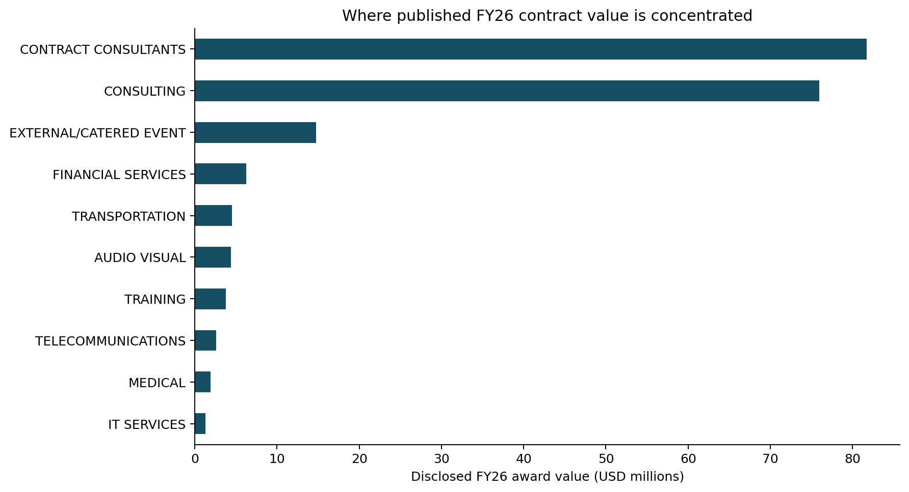
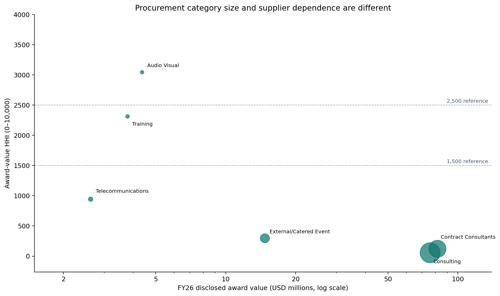
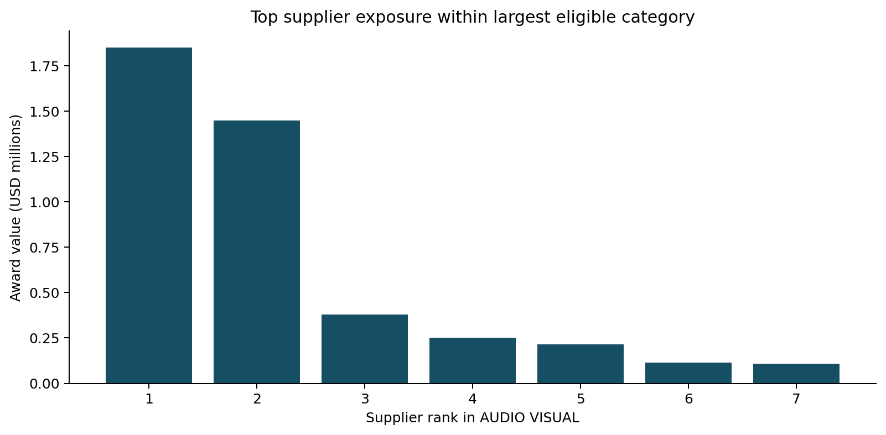
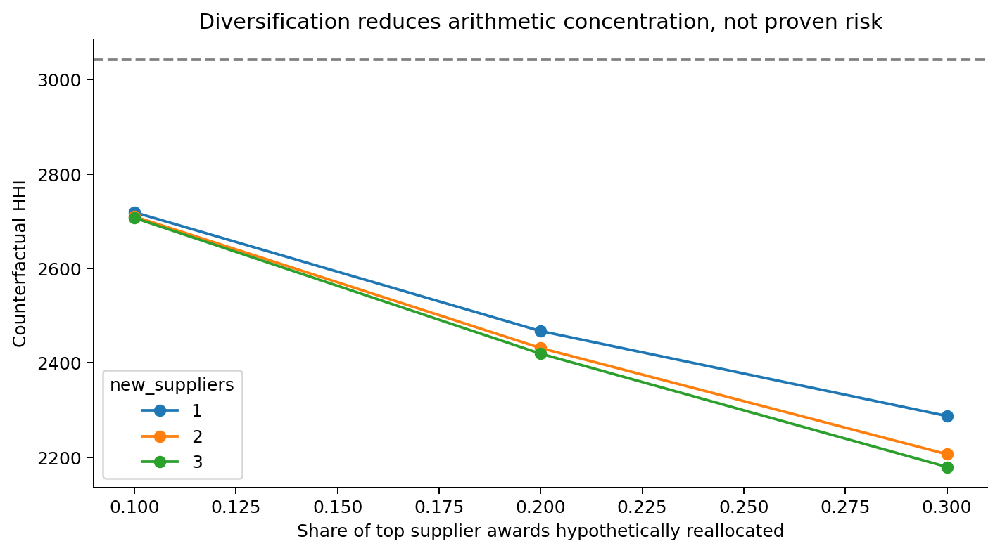
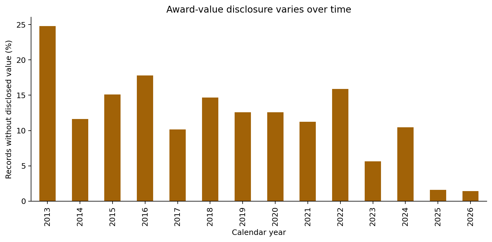

# Supply Chain Analytics Toolkit
### Case Study 01 — Strategic Sourcing Intelligence | World Bank FY2026

A reproducible Python case study examining a purchasing question: **do the largest procurement categories also show the greatest supplier dependence?** The answer in these published award records is no.

## Key findings

- **713 FY26 award records**, including **704 with positive disclosed values**, represent **$202.67 million** in published award value.
- **Contract Consultants and Consulting account for 77.8%** of disclosed value but have low award-value concentration (**HHI 122 and 56**).
- Smaller categories show much higher concentration: **Financial Services HHI 5,813** (five valued awards; largest supplier **73.7%**), **Transportation HHI 3,387** (largest supplier **54.5%**), and **Audio Visual HHI 3,043** (largest supplier **42.4%**).
- For **Audio Visual**, a *hypothetical* reallocation of 20% of the leading supplier's award value equally to two new suppliers changes modeled HHI from **3,042.7 to 2,431.4** (a **611.3-point** reduction). It is not an estimate of achievable savings.

**Main implication:** Purchasing value and supplier concentration are different dimensions. A sourcing review based only on the largest award categories could miss concentrated smaller categories.

## Research question and data

How can contract award records help identify supplier concentration and prioritize further sourcing analysis?

**Data:** World Bank Group, [Corporate Procurement Contract Awards (DS00028)](https://financesone.worldbank.org/d/DS00028), downloaded 7 November 2026, CC BY 4.0. The primary period is FY2026 (1 July 2025–30 June 2026). FY2026 was selected because the disclosure threshold changed during FY2025 (from $250,000 to $100,000); earlier years are not directly comparable without additional adjustments.

The dataset separates **Consulting** and **Contract Consultants** as distinct commodity-category labels. Their precise procurement scope is not established by these labels alone, so the analysis retains both rather than merging them.

## Method

Using pandas, NumPy and Matplotlib, the analysis checks missingness and repeated identifiers, aggregates disclosed award value by category and supplier, calculates top-supplier shares and **HHI = 10,000 × sum of squared supplier award-value shares**, and tests a counterfactual diversification scenario. Supplier names receive basic whitespace/case normalization; corporate-parent identities are not verified.

HHI values of 1,500 and 2,500 are shown on the concentration chart as *historical U.S. market-concentration reference points*. They are **not validated supplier-risk thresholds** for a single buyer's award portfolio.

## Results

### Category value



The two largest categories total **$157.67 million**, or **77.8%** of the disclosed FY26 award value. Their HHI scores are among the lowest in the category screen.

### Category concentration



| Category | Valued awards | Named suppliers | HHI | Largest supplier share |
|---|---:|---:|---:|---:|
| Contract Consultants | 234 | 212 | 122 | 3.6% |
| Consulting | 322 | 278 | 56 | 2.2% |
| Financial Services | 5 | 4 | 5,813 | 73.7% |
| Transportation | 9 | 9 | 3,387 | 54.5% |
| Audio Visual | 10 | 7 | 3,043 | 42.4% |

**Sample-size matters:** Medical has one valued award and therefore HHI 10,000 by construction. Financial Services has only five. For the diversification exercise, I therefore require at least **10 valued awards and three named suppliers**. This is a pragmatic screening rule, not a statistically validated threshold.

### Supplier exposure and scenario



Audio Visual's **top three suppliers account for 84.2%** of its disclosed award value (verified against `outputs/fy26_category_risk.csv`).



| Scenario | HHI (unrounded) | Interpretation |
|---|---:|---|
| Observed Audio Visual allocation | 3,042.7 | Baseline |
| Reallocate 20% of leading supplier's value to two new equal suppliers | 2,431.4 | 611.3-point modeled reduction |

The scenario changes an arithmetic concentration measure; it does not establish supplier availability, feasible switching, lower disruption risk or cost savings.

### Data quality



Across the full dataset, **500 of 4,799 records** have missing award amounts. Within FY26, **9 of 713** do. FY26 also contains **30 repeated non-null selection numbers**; these are not automatically duplicate rows. Award values can be estimated, and award records are not actual expenditure.

## Purchasing recommendations

1. **Validate supplier identities first.** Resolve aliases and parent-company relationships, then recalculate concentration before treating supplier counts as definitive.
2. **Review Audio Visual sourcing.** With **42.4%** allocated to the largest named supplier and **84.2%** to the top three, check service scope, qualified alternatives, capacity and switching constraints before proposing diversification.
3. **Run a 2–4 week data-enrichment review.** Collect comparable bids, delivery and quality evidence, contract conditions and supplier capacity. Review the two largest service categories for category-management opportunities separately from the smaller, more concentrated categories.

## Limitations

Published awards do not measure actual payments, comparable unit prices, delivery reliability or realized savings. Some values are estimates; supplier names may refer to related entities; and small category samples can produce extreme HHI scores. These findings prioritize questions for purchasing teams rather than prove that any supplier should be replaced.

## Reusable toolkit

The World Bank analysis is the **completed empirical case study**. General-purpose functions in `src/` also cover data quality, procurement, supplier concentration, delivery metrics and inventory analysis. Delivery and inventory functions require different datasets; they were **not used to infer unavailable World Bank performance measures**. See `examples/reuse_with_another_dataset.py` for an example.

## Repository and reproduction

- `data/raw/`: public source CSV
- `src/`: reusable functions
- `notebooks/`: exploratory and empirical notebooks
- `figures/`: five figures
- `outputs/`: auditable tables and sensitivity results
- `reports/executive_summary.md`: decision brief
- `tests/`: automated checks

Run from the repository root:

```bash
pip install -r requirements.txt
python build_portfolio.py
python run_analysis.py
python -m unittest discover -s tests -v
```

The build script regenerates the figures, FY26 tables and executive brief. The separate historical analysis is exploratory and should not be used to infer expenditure growth across the disclosure-threshold change.

## Attribution and responsible use

World Bank Group, *Corporate Procurement Contract Awards* (DS00028), [source](https://financesone.worldbank.org/d/DS00028), CC BY 4.0. This is an external case study using public data, not internal company procurement records.

This project was prepared with AI assistance. Its assumptions, code and data sources are provided for reproducibility; any claims of independent authorship should reflect the work personally completed and verified.
